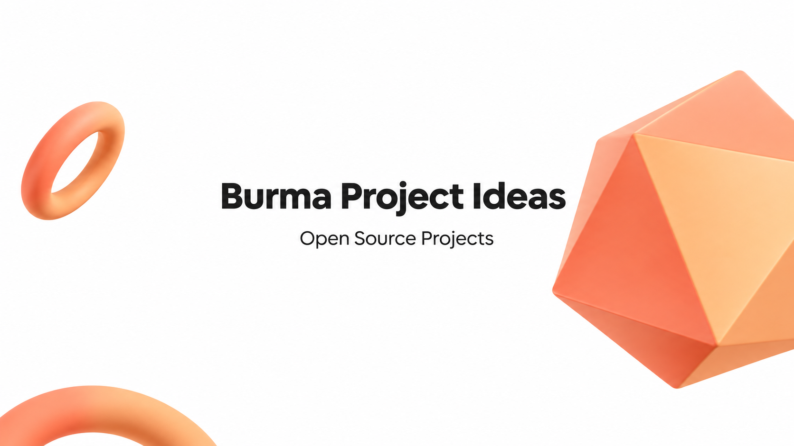

# Burma Project Ideas

"ဒီ 𝗣𝗿𝗼𝗷𝗲𝗰𝘁 တွေရဲ့ အဓိက ရည်ရွယ်ချက်က
နောက်လာမယ့်သူတွေအတွက်
လေ့လာလို့ရမယ် 𝙻𝚊𝚗𝚐𝚞𝚊𝚐𝚎 အလိုက်
𝗣𝗿𝗼𝗷𝗲𝗰𝘁 များစွာရှိစေချင်တဲ့ 
ရည်ရွယ်ချက်နဲ့ လုပ်ခဲ့တာပါ"

## Give a Star! :star:

If you like this repository to learn or start your solution, please give it a star. Thanks!

𝗚𝗶𝘁𝗛𝘂𝗯 𝗥𝗲𝗽𝗼𝘀𝗶𝘁𝗼𝗿𝘆 တစ်ခုဆီရဲ့ အောက်ဆုံးမှာ
ရေးထားပေးတဲ့သူတွေကို စုထားပေးပါတယ်
𝗟𝗮𝗻𝗴𝘂𝗮𝗴𝗲 တွေလည်း စုံတယ်
တော်တော်လေး သဘောကျတယ်ဗျာ
နောက်ထပ် ရေးပေးမယ့်သူတွေကိုလည်း
စောင့်မျှော်နေပါတယ်

𝗚𝗶𝘁𝗛𝘂𝗯 𝗥𝗲𝗽𝗼𝘀𝗶𝘁𝗼𝗿𝘆 မှာ
အမြဲ 𝗨𝗽𝗱𝗮𝘁𝗲 လုပ်ပေးနေပါမယ်

## Projects

Ordered by repository creation date, newest first. Dates come from GitHub's `created_at` field in UTC and are not confirmed project kickoff dates. Snapshot: 2026-11-04; Word List and Burglish added 2026-11-07. Contributors are GitHub accounts credited with commits, listed in contribution order; upstream data sources are credited where noted. The `.github` organization-profile repository and backup repositories are excluded.

| Project | Created&nbsp;date | Repository | Contributors / source credits |
| --- | :---: | --- | --- |
| Office Zoo | <code>2026&#8209;11&#8209;04</code> | [office-zoo](https://github.com/burma-project-ideas/office-zoo) | [@sannlynnhtun-coding](https://github.com/sannlynnhtun-coding) |
| Burma Calendar | <code>2026&#8209;09&#8209;01</code> | [burma-calendar](https://github.com/burma-project-ideas/burma-calendar) | [@sannlynnhtun-coding](https://github.com/sannlynnhtun-coding) |
| Burglish | <code>2026&#8209;08&#8209;20</code> | [burglish](https://github.com/burma-project-ideas/burglish) | [@sannlynnhtun-coding](https://github.com/sannlynnhtun-coding), [@theinhtetaung-dev](https://github.com/theinhtetaung-dev) |
| Word List | <code>2026&#8209;03&#8209;04</code> | [word-list](https://github.com/burma-project-ideas/word-list) · [Live app](https://blazor-word-list.vercel.app/) | [Kanaung Wordlists](https://github.com/kanaung/wordlists) (wordlist data), [@sannlynnhtun-coding](https://github.com/sannlynnhtun-coding) (app) |
| Mantra Calendar | <code>2025&#8209;08&#8209;21</code> | [mantra-calendar](https://github.com/burma-project-ideas/mantra-calendar) | [@sannlynnhtun-coding](https://github.com/sannlynnhtun-coding), [@myatphonethant-dev](https://github.com/myatphonethant-dev) |
| PhayarSar | <code>2024&#8209;06&#8209;09</code> | [phayar-sar](https://github.com/burma-project-ideas/phayar-sar) | [@sannlynnhtun-coding](https://github.com/sannlynnhtun-coding) |
| Banking Management System | <code>2024&#8209;03&#8209;15</code> | [banking-management-system](https://github.com/burma-project-ideas/banking-management-system) | [@sannlynnhtun-coding](https://github.com/sannlynnhtun-coding) |
| Burmese Agriculture | <code>2024&#8209;01&#8209;14</code> | [burmese-agriculture](https://github.com/burma-project-ideas/burmese-agriculture) | [@sannlynnhtun-coding](https://github.com/sannlynnhtun-coding), [@zinlynhtet](https://github.com/zinlynhtet) |
| Burmese Recipes | <code>2024&#8209;01&#8209;11</code> | [burmese-recipes](https://github.com/burma-project-ideas/burmese-recipes) | [@sannlynnhtun-coding](https://github.com/sannlynnhtun-coding), [@zinlynhtet](https://github.com/zinlynhtet), [@mgchit-coding](https://github.com/mgchit-coding) |
| Quotlets | <code>2024&#8209;01&#8209;06</code> | [quotlets](https://github.com/burma-project-ideas/quotlets) | [@sannlynnhtun-coding](https://github.com/sannlynnhtun-coding) |
| Missing Historical Records | <code>2023&#8209;12&#8209;23</code> | [missing-historical-records](https://github.com/burma-project-ideas/missing-historical-records) | [@sannlynnhtun-coding](https://github.com/sannlynnhtun-coding), [@zinlynhtet](https://github.com/zinlynhtet) |
| Incompatible Food | <code>2023&#8209;12&#8209;12</code> | [incompatible-food](https://github.com/burma-project-ideas/incompatible-food) | [@myatphonethant-dev](https://github.com/myatphonethant-dev), [@sannlynnhtun-coding](https://github.com/sannlynnhtun-coding) |
| Art Gallery | <code>2023&#8209;12&#8209;06</code> | [art-gallery](https://github.com/burma-project-ideas/art-gallery) | [@sannlynnhtun-coding](https://github.com/sannlynnhtun-coding) |
| Snakes | <code>2023&#8209;12&#8209;01</code> | [snakes](https://github.com/burma-project-ideas/snakes) | [@mgchit-coding](https://github.com/mgchit-coding), [@sannlynnhtun-coding](https://github.com/sannlynnhtun-coding), [@myatphonethant-dev](https://github.com/myatphonethant-dev), [@phyuphyuthin-coding](https://github.com/phyuphyuthin-coding) |
| Myanmar Months | <code>2023&#8209;11&#8209;25</code> | [myanmar-months](https://github.com/burma-project-ideas/myanmar-months) | [@sannlynnhtun-coding](https://github.com/sannlynnhtun-coding), [@phyuphyuthin-coding](https://github.com/phyuphyuthin-coding), [@myatphonethant-dev](https://github.com/myatphonethant-dev) |
| Birds | <code>2023&#8209;11&#8209;24</code> | [birds](https://github.com/burma-project-ideas/birds) | [@sannlynnhtun-coding](https://github.com/sannlynnhtun-coding), [@myatphonethant-dev](https://github.com/myatphonethant-dev) |
| Bagan Map | <code>2023&#8209;11&#8209;21</code> | [bagan-map](https://github.com/burma-project-ideas/bagan-map) | [@sannlynnhtun-coding](https://github.com/sannlynnhtun-coding), [@myatphonethant-dev](https://github.com/myatphonethant-dev) |
| Myanmar Proverbs | <code>2023&#8209;10&#8209;16</code> | [myanmar-proverbs](https://github.com/burma-project-ideas/myanmar-proverbs) | [@sannlynnhtun-coding](https://github.com/sannlynnhtun-coding), [@naykhantkyaw-coding](https://github.com/naykhantkyaw-coding), [@phyuphyuthin-coding](https://github.com/phyuphyuthin-coding), [@myatphonethant-dev](https://github.com/myatphonethant-dev) |
| Zodiac | <code>2023&#8209;10&#8209;15</code> | [zodiac](https://github.com/burma-project-ideas/zodiac) | [@sannlynnhtun-coding](https://github.com/sannlynnhtun-coding), [@OatSoeK](https://github.com/OatSoeK), [@myatphonethant-dev](https://github.com/myatphonethant-dev), [@naykhantkyaw-coding](https://github.com/naykhantkyaw-coding), [@phyuphyuthin-coding](https://github.com/phyuphyuthin-coding), [@mgchit-coding](https://github.com/mgchit-coding) |
| Pick A Pile | <code>2023&#8209;10&#8209;12</code> | [pick-a-pile](https://github.com/burma-project-ideas/pick-a-pile) | [@sannlynnhtun-coding](https://github.com/sannlynnhtun-coding), [@OatSoeK](https://github.com/OatSoeK) |
| Movie Ticket Online Booking System | <code>2023&#8209;10&#8209;07</code> | [movie-ticket-online-booking-system](https://github.com/burma-project-ideas/movie-ticket-online-booking-system) | [@mgchit-coding](https://github.com/mgchit-coding), [@sannlynnhtun-coding](https://github.com/sannlynnhtun-coding), [@OatSoeK](https://github.com/OatSoeK), [@phyuphyuthin-coding](https://github.com/phyuphyuthin-coding) |
| Dream Dictionary | <code>2023&#8209;10&#8209;07</code> | [dream-dictionary](https://github.com/burma-project-ideas/dream-dictionary) | [@sannlynnhtun-coding](https://github.com/sannlynnhtun-coding), [@OatSoeK](https://github.com/OatSoeK) |
| Min Thein Kha - Lat Htauk Bay Din | <code>2023&#8209;10&#8209;05</code> | [min-thein-kha-lat-htauk-bay-din](https://github.com/burma-project-ideas/min-thein-kha-lat-htauk-bay-din) | [@sannlynnhtun-coding](https://github.com/sannlynnhtun-coding), [@OatSoeK](https://github.com/OatSoeK) |

## Word List

[Open the dictionary](https://blazor-word-list.vercel.app/) · [Open the spell checker](https://blazor-word-list.vercel.app/spell-check) · [Read the workflow and setup guide](https://github.com/burma-project-ideas/word-list#readme)

မြန်မာစကားလုံးတွေကို အစစာလုံးအလိုက် ရှာဖွေနိုင်ပြီး စာလုံးပေါင်းစစ်ခြင်း၊ အကြံပြုစကားလုံးရွေးခြင်းနဲ့ စာသားကို `.txt` အဖြစ် သိမ်းခြင်းတို့ လုပ်နိုင်ပါတယ်။ Mobile Layout၊ Light/Dark Theme နဲ့ Keyboard အသုံးပြုမှုကိုလည်း ပံ့ပိုးထားပါတယ်။ စာလုံးပေါင်းစစ်ခြင်းကို Browser ထဲမှာပဲ လုပ်ဆောင်ပါတယ်။

Wordlist data: [Kanaung Wordlists and its contributors](https://github.com/kanaung/wordlists). App: [Sann Lynn Htun](https://github.com/sannlynnhtun-coding). The Blazor interface adapts [Prestige UI](https://prestigeui.com/) components; [credits and licenses](https://github.com/burma-project-ideas/word-list/blob/master/THIRD_PARTY_NOTICES.md) are included in the project.

## More project ideas

- [NatMyatSi](./nat-myat-si)

